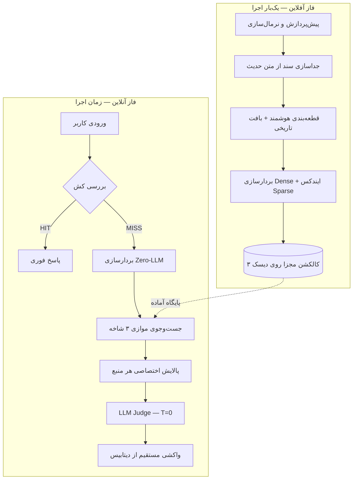

<div align="center">

# Zero-Hallucination Islamic RAG

**سامانه هوشمند تطبیق معنایی و استخراج مستندِ متون دینی**

قرآن کریم · نهج‌البلاغه · الکافی


-green)


</div>

---

## فهرست

- [معرفی پروژه](#معرفی-پروژه)
- [مسئله](#مسئله)
- [ایده‌ی محوری](#ایدهی-محوری)
- [معماری کلی](#معماری-کلی)
- [ساختار مخزن](#ساختار-مخزن)
- [مستندات](#مستندات)
- [نقشه راه](#نقشه-راه)
- [شاخص‌های کلیدی (KPIs)](#شاخصهای-کلیدی-kpis)
- [وضعیت فعلی](#وضعیت-فعلی)
- [مشارکت](#مشارکت)
- [سلب مسئولیت علمی و دینی](#سلب-مسئولیت-علمی-و-دینی)

---

## معرفی پروژه

`Zero-Hallucination Islamic RAG` یک معماری برای حل یک مسئله‌ی مشخص است: **پیدا کردن دقیق‌ترین آیه، خطبه، نامه، حکمت یا حدیثی که با یک گزاره‌ی نوشتاری (ادعا، ایده، پاراگراف) هم‌خوانی محتوایی و منطقی دارد.**

این سامانه عمداً از روش رایج «از مدل زبانی بخواه متن دینی بنویسد» فاصله می‌گیرد. در این معماری:

> **مدل زبانی بزرگ (LLM) هیچ آیه یا حدیثی تولید، بازنویسی یا بازنویسی‌معنایی نمی‌کند.**
> تمام متن نهایی — با اعراب، ترجمه و آدرس دقیق — **مستقیماً از پایگاه داده** خوانده می‌شود.

نقش LLM فقط یک **لایه‌ی داوری (Judge)** است: بررسی می‌کند که آیا سندِ استخراج‌شده از نظر *شأن نزول* و *جهت منطقی (نفی/اثبات)* واقعاً با ورودی کاربر هم‌خوانی دارد یا نه. این تفکیک، توهم متنی و آدرسی را عملاً به صفر می‌رساند.

## مسئله

هنگام نگارش یک متن یا مقاله، یافتن مستند دینی دقیق برای یک گزاره با چهار شکست رایج روبه‌روست:

| # | شکست | توضیح |
|---|------|-------|
| ۱ | **توهم در متن و آدرس** | جابه‌جایی کلمات عربی، جعل سند حدیث، اشتباه در شماره‌ی آیه یا باب |
| ۲ | **کلی‌گویی** | پناه بردن به مفاهیم کلیشه‌ای (مثل «صبر» یا «تقوا») به‌جای یافتن روایت دقیق برای یک گزاره‌ی خاص |
| ۳ | **نادیده گرفتن شأن نزول** | پیوند دادن یک آیه‌ی مرتبط با واقعه‌ای خاص به یک موضوع مدرنِ بی‌ربط |
| ۴ | **خطای جهت منطقی** | ناتوانی در تشخیص تفاوت میان «تأیید یک صفت» و «مذمت همان صفت» |

## ایده‌ی محوری

1. **بازیابی صفر-توکن:** ورودی کاربر فقط یک‌بار به بردار ریاضی تبدیل می‌شود؛ هیچ LLM‌ای در مرحله‌ی بازیابی دخالت ندارد.
2. **بازیابی ترکیبی موازی سه‌شاخه:** جست‌وجوی هم‌زمان و مستقل در سه مخزن (قرآن، نهج‌البلاغه، الکافی) با سهمیه‌ی جداگانه.
3. **پالایش اختصاصی هر منبع:** ادغام آیات متوالی، حذف تکرار با MMR، و وزن‌دهی اعتبار سند برای احادیث.
4. **داوری هوشمند با دمای صفر:** یک LLM ناظر فقط شناسه‌ها را تأیید یا رد می‌کند (بدون تولید متن).
5. **واکشی مستقیم (Hydration):** متن نهایی از دیتابیس خوانده و نمایش داده می‌شود.

## معماری کلی

نظام به دو فاز کاملاً مستقل تقسیم می‌شود تا در زمان استفاده، هزینه‌ی توکن و تأخیر حداقل باشد:



جزئیات کامل در [`docs/architecture.md`](docs/architecture.md).

## ساختار مخزن

```text
.
├── README.md                     ← همین فایل
├── code_artifact.md              ← پروپوزال فنی اصلی (سند مرجع)
├── CONTRIBUTING.md               ← راهنمای مشارکت
├── CHANGELOG.md                  ← تاریخچه تغییرات
└── docs/
    ├── architecture.md           ← معماری کلان و تصمیم‌های طراحی
    ├── data-pipeline.md          ← مهندسی داده و ایندکسینگ آفلاین
    ├── retrieval-and-verification.md ← موتور بازیابی و لایه داوری
    ├── tech-stack.md             ← زیرساخت فنی و انتخاب فناوری‌ها
    ├── evaluation.md             ← ارزیابی، معیارها و کالیبراسیون
    ├── roadmap.md                ← نقشه راه اجرایی ۶ فازی
    └── glossary.md               ← واژه‌نامه اصطلاحات
```

> این مخزن در حال حاضر **فقط مستندات است** و هیچ کد اجرایی ندارد. پیاده‌سازی در فازهای بعدی و بر اساس مستندات همین مخزن انجام می‌شود.

## مستندات

| سند | موضوع |
|-----|-------|
| [architecture.md](docs/architecture.md) | تفکیک فاز آفلاین/آنلاین، جریان داده، تصمیم‌های طراحی |
| [data-pipeline.md](docs/data-pipeline.md) | منابع داده، نرمال‌سازی، تفکیک سند، چانکینگ، متادیتا |
| [retrieval-and-verification.md](docs/retrieval-and-verification.md) | جست‌وجوی موازی، فیلتر آستانه، MMR، داوری، واکشی |
| [tech-stack.md](docs/tech-stack.md) | Python، مدل‌های امبدینگ، دیتابیس برداری، LLM، NLI |
| [evaluation.md](docs/evaluation.md) | KPI‌ها، دیتاست تست، معیارها، کالیبراسیون آستانه |
| [roadmap.md](docs/roadmap.md) | ۶ فاز عملیاتی از صفر تا صد |
| [glossary.md](docs/glossary.md) | تعریف اصطلاحات فنی و متون |

## نقشه راه

| فاز | موضوع | بازه |
|-----|-------|------|
| ۱ | گردآوری و مهندسی داده | هفته ۱–۲ |
| ۲ | پایگاه داده برداری و ایندکس آفلاین | هفته ۳ |
| ۳ | موتور بازیابی موازی و پالایش | هفته ۴ |
| ۴ | لایه داوری و گاردریل عدم توهم | هفته ۵ |
| ۵ | ارزیابی و تنظیم آستانه‌ها | هفته ۶ |
| ۶ | رابط کاربری و ورودی‌های طولانی | توسعه‌ی آتی |

توضیحات هر فاز در [`docs/roadmap.md`](docs/roadmap.md).

## شاخص‌های کلیدی (KPIs)

| شاخص | هدف | یادداشت |
|------|-----|---------|
| نرخ توهم متنی و آدرسی | ۰٪ | چون متن از دیتابیس خوانده می‌شود، نه از LLM |
| دقت تشخیص شأن نزول | حذف >۹۵٪ شباهت‌های لفظی بی‌ربط | نیازمند معیار دقیق [TODO] |
| میانگین مصرف توکن هر درخواست | < ۱۵۰۰ توکن | فقط در مرحله‌ی داوری |
| زمان پاسخ‌گویی | < ۲.۵ ثانیه | از ورود گزاره تا نمایش مستند |

> نکته‌ی مهم: KPI «نرخ توهم» را به دو بخش تفکیک می‌کنیم — **توهم متنی/آدرسی** (هدف: ۰٪) و **خطای گزینش داور** (هدف: با معیار مشخص). جزئیات در [`docs/evaluation.md`](docs/evaluation.md).

## وضعیت فعلی

- [x] تدوین پروپوزال فنی و معماری
- [x] مستندسازی معماری، داده، بازیابی، فناوری و ارزیابی
- [ ] قطعی‌سازی انتخاب مدل امبدینگ و دیتابیس برداری
- [ ] پیاده‌سازی فاز آفلاین
- [ ] پیاده‌سازی موتور بازیابی و لایه داوری
- [ ] ارزیابی و کالیبراسیون
- [ ] رابط کاربری

## مشارکت

پیش از ارسال تغییرات، [`CONTRIBUTING.md`](CONTRIBUTING.md) را بخوانید. خلاصه:
از برنچ‌های موضوعی استفاده کنید، پیام‌های کامیت را واضح بنویسید و تغییرات مستندات را با Pull Request ارائه دهید.

## سلب مسئولیت علمی و دینی

- این پروژه یک ابزار **کمک‌پژوهشی** است و جایگزین بررسی تخصصی حوزوی و رجالی نیست.
- مقادیری مانند «وزن اعتبار سندی» صرفاً **امتیازهای الگوریتمی** برای رتبه‌بندی هستند، نه حکم قطعی درباره‌ی صحت یا ضعف احادیث.
- اصل متن متون دینی از منابع معتبر و نسخه‌های مشخص خوانده می‌شود؛ نسخه‌ها و ترجمه‌های استفاده‌شده باید مستند و شفاف باشند.

---

<div align="center">
<sub>ساخته‌شده برای پژوهش‌گران، نویسندگان و تولیدکنندگان محتوای دینی</sub>
</div>
