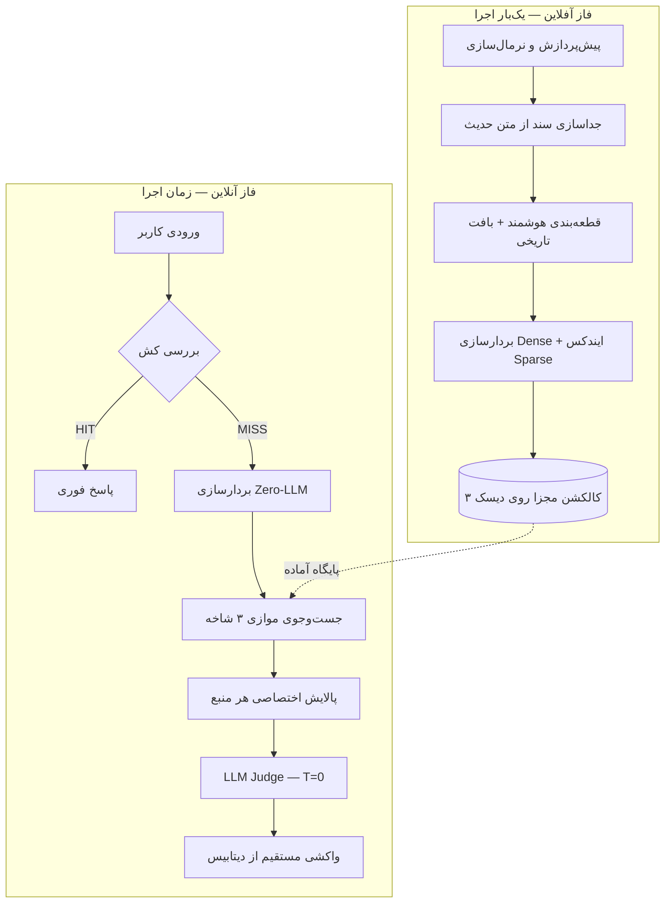
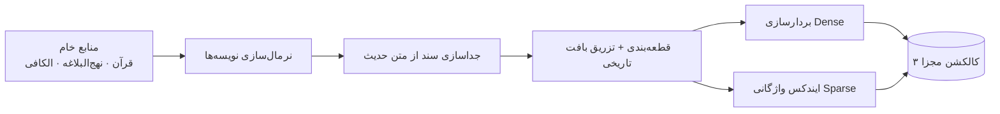
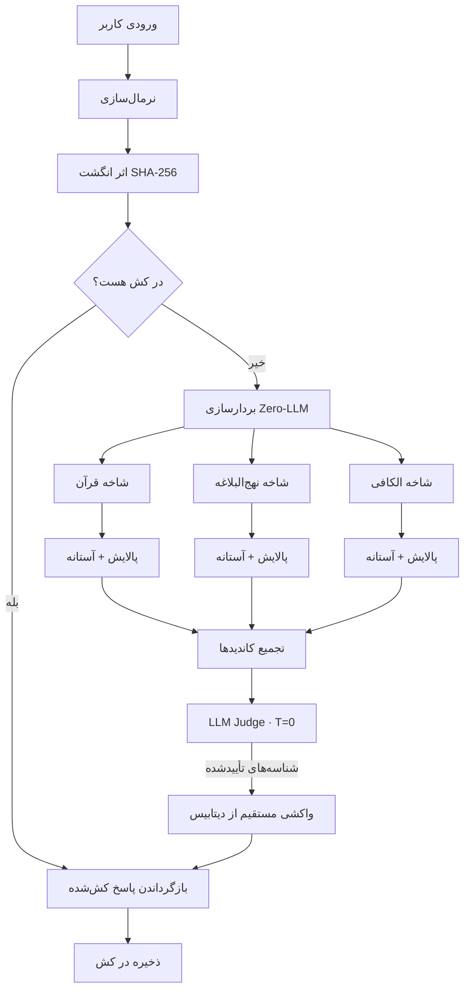

# معماری کلان سیستم

> این سند تفکیک فاز آفلاین/آنلاین، جریان داده و تصمیم‌های طراحی سامانه را شرح می‌دهد.
> سند مرجع: [`../code_artifact.md`](../code_artifact.md)

## فهرست

- [اصول طراحی](#اصول-طراحی)
- [نمای کلی معماری](#نمای-کلی-معماری)
- [فاز ۱ — پایپلاین آفلاین](#فاز-۱--پایپلاین-آفلاین)
- [فاز ۲ — پایپلاین آنلاین](#فاز-۲--پایپلاین-آنلاین)
- [جریان داده انتها-به-انتها](#جریان-داده-انتها-به-انتها)
- [زیرسیستم‌ها](#زیرسیستمها)
- [تصمیم‌های طراحی و دلیل آن‌ها](#تصمیمهای-طراحی-و-دلیل-آنها)
- [تصمیم‌های باز](#تصمیمهای-باز)

## اصول طراحی

1. **LLM تولیدکننده نیست، داور است.** متن نهایی هرگز توسط مدل زبانی ساخته نمی‌شود.
2. **تفکیک کامل آفلاین و آنلاین.** متون دینی ثابت‌اند؛ پردازش و بردارسازی آن‌ها نباید در هر اجرا تکرار شود.
3. **بازیابی صفر-توکن.** هیچ LLM‌ای در مرحله‌ی بازیابی دخالت ندارد؛ فقط بردار ریاضی و ایندکس واژگانی.
4. **سهمیه‌ی مستقل هر منبع.** هیچ کتابی نباید در نتایج، منابع دیگر را به حاشیه براند.
5. **قابل‌ردیابی بودن (Traceability).** هر خروجی باید به شناسه‌ی دقیق سند در دیتابیس متصل باشد.

## نمای کلی معماری

تصویر کلان هر دو فاز و نحوه‌ی اتصال آن‌ها:



## فاز ۱ — پایپلاین آفلاین

فقط **یک‌بار** پیش از راه‌اندازی سامانه اجرا می‌شود و خروجی روی دیسک ذخیره می‌گردد.



مراحل:

1. **پیش‌پردازش، نرمال‌سازی و جداسازی سند از متن.**
2. **قطعه‌بندی هوشمند و تزریق بافت تاریخی (Contextual Chunking).**
3. **بردارسازی ترکیبی و ذخیره‌سازی در ۳ کالکشن مجزا.**

جزئیات در [`data-pipeline.md`](data-pipeline.md).

## فاز ۲ — پایپلاین آنلاین

زمانی فعال می‌شود که کاربر گزاره‌ای را وارد می‌کند؛ دیتابیس از قبل آماده است.



مراحل:

1. لایه ورودی و حافظه پنهان (Cache Layer).
2. تبدیل ورودی به بردار (Zero-LLM Vectorization).
3. توزیع موازی در ۳ شاخه و بازیابی اختصاصی.
4. تجمیع، داوری هوشمند و واکشی مستقیم.

جزئیات در [`retrieval-and-verification.md`](retrieval-and-verification.md).

## جریان داده انتها-به-انتها

```text
گزاره کاربر
   │  نرمال‌سازی + SHA-256
   ▼
[کش] ── HIT ───────────────────────────────► پاسخ
   │ MISS
   ▼
بردار Dense + کلیدواژه‌ها
   │
   ├─► (قرآن)      top-k → آستانه → Verse Merger ─┐
   ├─► (نهج‌البلاغه) top-k → آستانه → MMR           ├─► بسته کاندید (≤ ۹)
   └─► (الکافی)    top-k → آستانه → MMR + سند      ┘
   │
   ▼
LLM Judge (T=0): تأیید / رد شناسه‌ها
   │
   ▼
واکشی متن عربی + ترجمه + آدرس از دیتابیس
   │
   ▼
نمایش در دو بخش: «تطبیق اصلی» و «شواهد پشتیبان»
```

## زیرسیستم‌ها

| زیرسیستم | مسئولیت | ورودی | خروجی |
|----------|---------|-------|-------|
| Preprocessor | نرمال‌سازی و پاک‌سازی | متون خام | متون تمیز |
| Isnad Splitter | تفکیک سلسله راویان از متن حدیث | حدیث خام | متن خالص + متادیتای سند |
| Chunker | قطعه‌بندی و تزریق بافت | متن تمیز | قطعات معنایی + متادیتا |
| Embedder | تولید بردار Dense | قطعه | بردار عددی |
| Sparse Indexer | ایندکس واژگانی/ریشه‌ای | قطعه | ایندکس معکوس |
| Retriever | جست‌وجوی موازی ۳ شاخه | بردار + کلیدواژه | کاندیدهای خام |
| Refiner | پالایش اختصاصی هر منبع | کاندیدهای خام | کاندیدهای تمیز |
| Verifier | داوری شأن نزول و جهت منطقی | کاندیدها + بافت | شناسه‌های تأییدشده |
| Hydrator | واکشی مستقیم متن و آدرس | شناسه‌ها | خروجی نهایی |
| Cache | جلوگیری از پردازش تکراری | گزاره | پاسخ کش‌شده |

## تصمیم‌های طراحی و دلیل آن‌ها

| تصمیم | دلیل |
|-------|------|
| تفکیک سند از متن حدیث پیش از امبدینگ | سلسله راویان (مثل «عدة من أصحابنا عن أحمد بن محمد...») بردار را نویزی می‌کند و معنای خالص کلام معصوم را رقیق می‌سازد |
| سه کالکشن مجزا | حجم بالای روایات الکافی (~۱۶٬۰۰۰ حدیث) نباید سهم آیات و نهج‌البلاغه را در نتایج کمرنگ کند |
| عدم تولید متن توسط LLM | حذف کامل توهم متنی و آدرسی |
| داور با دمای T=0 | کاهش واریانس تصمیم و افزایش بازتولیدپذیری گزینش |
| آستانه‌ی ریاضی قبل از داور | جلوگیری از ورود اسناد بی‌ربط به مرحله‌ی پرهزینه‌ی داوری |
| واکشی نهایی مستقیم از دیتابیس | تضمین تطابق دقیق متن، اعراب و آدرس با منبع |

## تصمیم‌های باز

موارد زیر به تصمیم‌گیری و کالیبراسیون نیاز دارند (جزئیات بیشتر در [`tech-stack.md`](tech-stack.md) و [`evaluation.md`](evaluation.md)):

- **مدل امبدینگ:** مدل عمومی چندزبانه یا مدل تخصصی عربی/فاین‌تیون‌شده؟
- **دیتابیس برداری:** انتخاب بین گزینه‌های موجود و پشتیبانی از جست‌وجوی ترکیبی.
- **آستانه‌ی شباهت:** مقدار ثابت `0.80` ریسک خالی‌شدن شاخه‌ها دارد؛ آستانه‌ی پویا/نسبی پیشنهاد می‌شود.
- **سازوکار Sparse:** استخراج کلیدواژه و ریشه‌یابی عربی باید بدون مصرف توکن LLM مشخص شود.
- **ریسک رقیق‌شدن بردار:** آیا بافت (آیه قبل/بعد و شأن نزول) داخل متن امبدشده بیاید یا فقط در متادیتا بماند؟
- **بودجه‌ی توکن داور:** ۹ کاندید همراه بافت احتمالاً از ۱۵۰۰ توکن عبور می‌کند.
