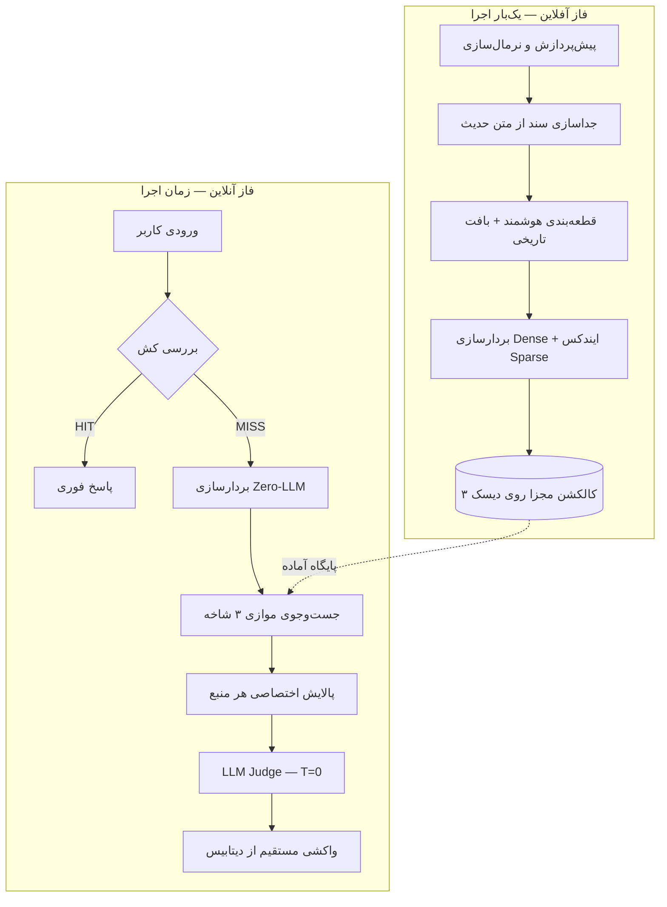
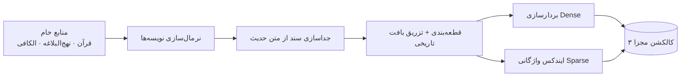
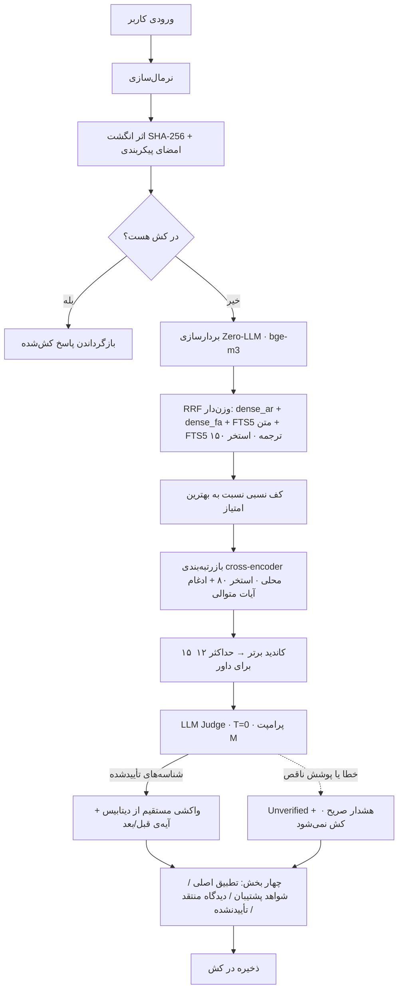

# معماری کلان سیستم

> این سند تفکیک فاز آفلاین/آنلاین، جریان داده و تصمیم‌های طراحی سامانه را شرح می‌دهد.
> سند مرجع: [`../code_artifact.md`](../code_artifact.md)

## فهرست

- [اصول طراحی](#اصول-طراحی)
- [نمای کلی معماری](#نمای-کلی-معماری)
- [فاز ۱ — پایپلاین آفلاین](#فاز-۱--پایپلاین-آفلاین)
- [فاز ۲ — پایپلاین آنلاین](#فاز-۲--پایپلاین-آنلاین)
- [جریان داده انتها-به-انتها](#جریان-داده-انتها-به-انتها)
- [زیرسیستم‌ها](#زیرسیستمها)
- [تصمیم‌های طراحی و دلیل آن‌ها](#تصمیمهای-طراحی-و-دلیل-آنها)
- [تصمیم‌های باز](#تصمیمهای-باز)

## اصول طراحی

1. **LLM تولیدکننده نیست، داور است.** متن نهایی هرگز توسط مدل زبانی ساخته نمی‌شود.
2. **تفکیک کامل آفلاین و آنلاین.** متون دینی ثابت‌اند؛ پردازش و بردارسازی آن‌ها نباید در هر اجرا تکرار شود.
3. **بازیابی صفر-توکن.** هیچ LLM‌ای در مرحله‌ی بازیابی دخالت ندارد؛ فقط بردار ریاضی و ایندکس واژگانی.
4. **سهمیه‌ی مستقل هر منبع.** هیچ کتابی نباید در نتایج، منابع دیگر را به حاشیه براند.
5. **قابل‌ردیابی بودن (Traceability).** هر خروجی باید به شناسه‌ی دقیق سند در دیتابیس متصل باشد.

## نمای کلی معماری

تصویر کلان هر دو فاز و نحوه‌ی اتصال آن‌ها:



## فاز ۱ — پایپلاین آفلاین

فقط **یک‌بار** پیش از راه‌اندازی سامانه اجرا می‌شود و خروجی روی دیسک ذخیره می‌گردد.



مراحل:

1. **پیش‌پردازش، نرمال‌سازی و جداسازی سند از متن.**
2. **قطعه‌بندی هوشمند و تزریق بافت تاریخی (Contextual Chunking).**
3. **بردارسازی ترکیبی و ذخیره‌سازی در ۳ کالکشن مجزا.**

جزئیات در [`data-pipeline.md`](data-pipeline.md).

## فاز ۲ — پایپلاین آنلاین

زمانی فعال می‌شود که کاربر گزاره‌ای را وارد می‌کند؛ دیتابیس از قبل آماده است.



مراحل:

1. لایه ورودی و حافظه پنهان (کش آگاه از پیکربندی و هش پرامپت).
2. تبدیل ورودی به بردار (Zero-LLM Vectorization).
3. فیوژن RRF چهار لیست، کف نسبی، بازرتبه‌بندی محلی و ادغام آیات متوالی.
4. داوری هوشمند (فقط گزینش شناسه) و واکشی مستقیم بایت‌دقیق.

> طرح چندمنبعی (۳ شاخه‌ی موازی قرآن/نهج‌البلاغه/الکافی با سهمیه و پالایش اختصاصی هر منبع) معماری هدف است؛ در نسخه‌ی فعلی فقط شاخه‌ی قرآن پیاده‌سازی شده و طرح‌واره‌ی دیتابیس منبع-agnostic است.

جزئیات در [`retrieval-and-verification.md`](retrieval-and-verification.md).

## جریان داده انتها-به-انتها

```text
گزاره کاربر
   │  نرمال‌سازی + SHA-256 + امضای پیکربندی
   ▼
[کش] ── HIT ───────────────────────────────► پاسخ
   │ MISS
   ▼
بردار Dense (ar/fa) + کلیدواژه‌های FTS5
   │
   ▼
RRF وزن‌دار (استخر ۱۵۰) → کف نسبی
   │
   ▼
(قرآن) ۸۰ کاندید → ادغام آیات متوالی → بازرتبه‌بند cross-encoder → ۱۵ برتر
   │
   ▼
LLM Judge (T=0): حداکثر ۱۲ کاندید → تأیید / رد / Unverified هنگام شکست
   │
   ▼
واکشی متن عربی + ترجمه + آدرس + آیه‌ی قبل/بعد از دیتابیس
   │
   ▼
نمایش در چهار بخش: «تطبیق اصلی»، «شواهد پشتیبان»، «دیدگاه منتقد»، «تأییدنشده»
```

## زیرسیستم‌ها

| زیرسیستم | مسئولیت | ورودی | خروجی |
|----------|---------|-------|-------|
| Preprocessor | نرمال‌سازی و پاک‌سازی | متون خام | متون تمیز |
| Isnad Splitter | تفکیک سلسله راویان از متن حدیث | حدیث خام | متن خالص + متادیتای سند |
| Chunker | قطعه‌بندی و تزریق بافت | متن تمیز | قطعات معنایی + متادیتا |
| Embedder | تولید بردار Dense | قطعه | بردار عددی |
| Sparse Indexer | ایندکس واژگانی FTS5 (BM25، بدون ریشه‌یاب) | قطعه | ایندکس معکوس |
| Retriever | فیوژن RRF چهار لیست + بازرتبه‌بندی محلی (فعلاً قرآن؛ طرح هدف: ۳ شاخه موازی) | بردار + کلیدواژه | کاندیدهای خام |
| Refiner | پالایش اختصاصی هر منبع | کاندیدهای خام | کاندیدهای تمیز |
| Verifier | داوری بافت (شأن نزول/محدودیت متنی)، دروازه‌ی موضوع و جهت منطقی | کاندیدها (متن + ترجمه + متادیتا) | شناسه‌های تأییدشده |
| Hydrator | واکشی مستقیم متن و آدرس | شناسه‌ها | خروجی نهایی |
| Cache | جلوگیری از پردازش تکراری | گزاره | پاسخ کش‌شده |

## تصمیم‌های طراحی و دلیل آن‌ها

| تصمیم | دلیل |
|-------|------|
| تفکیک سند از متن حدیث پیش از امبدینگ | سلسله راویان (مثل «عدة من أصحابنا عن أحمد بن محمد...») بردار را نویزی می‌کند و معنای خالص کلام معصوم را رقیق می‌سازد |
| سهمیه‌ی مستقل هر منبع (طرح سه‌کالکشنی) | حجم بالای روایات الکافی (~۱۶٬۰۰۰ حدیث) نباید سهم آیات و نهج‌البلاغه را در نتایج کمرنگ کند؛ فعلاً یک دیتابیس منبع-agnostic با ستون `source` |
| عدم تولید متن توسط LLM | حذف کامل توهم متنی و آدرسی |
| داور با دمای T=0 | کاهش واریانس تصمیم و افزایش بازتولیدپذیری گزینش |
| استخر رتبه‌بندی + رتبه‌بند پیش از داور | به‌جای آستانه‌ی ثابت کسینوسی (ریسک خالی‌شدن شاخه‌ها)، ۱۵۰ کاندید RRF → ۸۰ کاندید رتبه‌بند → ۱۲ کاندید داور؛ گزینش نسبی است نه آستانه‌ی مطلق |
| واکشی نهایی مستقیم از دیتابیس | تضمین تطابق دقیق متن، اعراب و آدرس با منبع |

## تصمیم‌های باز (باقی‌مانده)

موارد زیر هنوز تصمیم نهایی ندارند (جزئیات بیشتر در [`tech-stack.md`](tech-stack.md) و [`evaluation.md`](evaluation.md)):

- **پیش‌فیلتر NLI:** مدل کوچک استنتاج زبان‌طبیعی برای تشخیص نفی/جهت، پیش از داور — نیازمند ارزیابی روی تله‌های نفی.
- **کش معنایی:** گزاره‌های نزدیک‌المعنا فعلاً کش جداگانه می‌گیرند؛ کش مبتنی بر شباهت بردار پیاده‌سازی نشده.
- **فاین‌تیون امبدینگ:** روی جفت‌های حدیثی/قرآنی — گزینه‌ی ارتقای آتی.
- **دیتابیس برداری در مقیاس الکافی:** جست‌وجوی کامل کسینوسی فعلی برای ~۶٬۲۳۶ آیه کافی است؛ برای ده‌ها هزار حدیث ممکن است ANN لازم شود.
- **داده‌ی شأن نزول و شرایط فقهی:** در منبع وجود ندارد؛ افزودن بانک شأن نزول معتبر، دقت تله‌های تاریخی/فقهی را بالا می‌برد.

تصمیم‌های پیشین که **قطعی و اندازه‌گیری‌شده** هستند: مدل امبدینگ (`bge-m3` دو-برداره)، دیتابیس (`SQLite` + `numpy`)، سازوکار Sparse (`FTS5` بدون ریشه‌یاب و بدون توکن)، متن خالص برای امبدینگ (بافت فقط در دیتابیس/متادیتا)، و بودجه‌ی داور (~۲۹۶۵ توکن کل برای هر درخواست با ۱۲ کاندید + ترجمه؛ هدف اولیه‌ی ۱۵۰۰ خوش‌بینانه بود و tradeoff آگاهانه پذیرفته شد).
